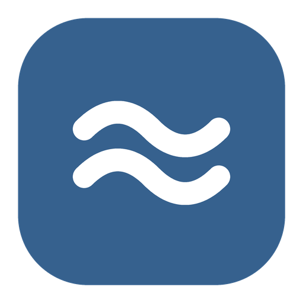

# WaveMini



The [Wave](https://github.com/ReUnknown/Wave) mini player as its own tiny Windows app: an ad-free YouTube Music client that lives entirely in one small window. No big app behind it: sign-in, home, search, Up next, lyrics, artists, albums, your library and account all fit inside the mini player.

Written in native Windows code (C++, no browser engine, no Java) to be small, fast and light on memory. The whole app is one file under 1 MB.

> **Beta.** Things will break. YouTube changes often, and playback is the first thing to go when it does.

## Get it

Download from [Releases](https://github.com/ReUnknown/WaveMini/releases):

- **WaveMini-Setup.exe** installs it: Start menu shortcut, an entry in Windows' installed apps, updates itself.
- **WaveMini.exe** is the same app without installing: run it from anywhere.

Windows will warn that the app is from an unknown publisher (it isn't signed): choose **More info**, then **Run anyway**.

Needs Windows 10 or 11. Signing in uses Microsoft Edge WebView2, which Windows 11 already has.

## What it does

- **Plays YouTube Music without ads**, signed in or not.
- **Home and search** in one tab, with suggestions while you type.
- **Up next**: drag songs to reorder, play next, add to queue, radio.
- **Lyrics** sung word by word.
- **Your library**: likes, history, playlists, albums, artists. Save albums, make playlists, add and remove songs.
- **Floats on top**, snaps to a corner, and tucks against the edge of the screen as a small round button.
- **Media keys** and Windows' media popup work from any app.
- **Light**: drawn on the CPU with no graphics driver loaded, one song cached at a time, and memory handed back when it's tucked away.

## Build it

Needs Visual Studio 2022 (C++), CMake, and the `Microsoft.Web.WebView2` NuGet package unpacked somewhere.

```
cmake -B build -A x64 -DWEBVIEW2_DIR=path\to\Microsoft.Web.WebView2.1.0.2903.40
cmake --build build --config Release
```

`WaveMini.exe --render some\folder` saves a picture of every screen, which is how the look is checked on every push.

## License

GPL-3.0, same as Wave. WaveMini isn't affiliated with YouTube or Google.
